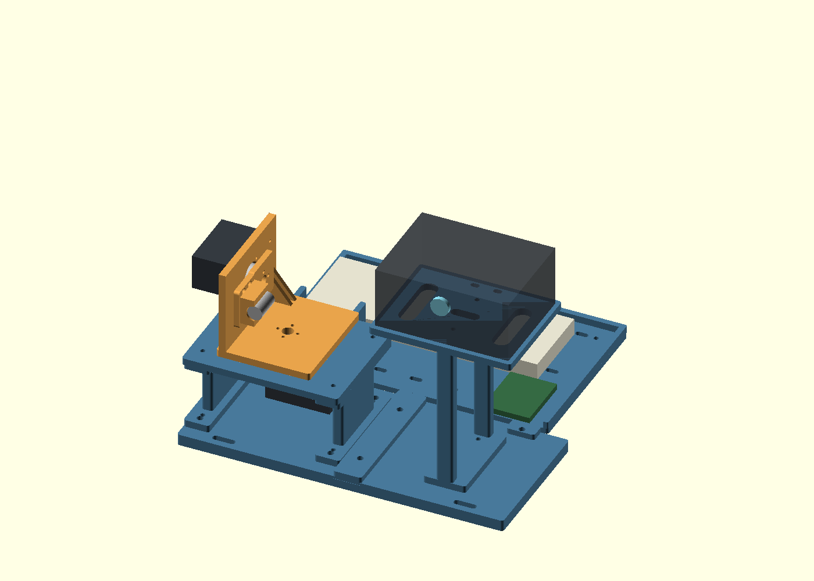

# Laser Turret Research Platform

An open, work-in-progress robotics project for camera-based object detection,
multi-object tracking, pan/tilt simulation, and eventual laser-free
hardware-in-the-loop testing.

The project combines a Python perception stack with an OpenSCAD mechanical design
and a planned MuJoCo digital twin. The immediate focus is reliable object tracking
from recorded and live camera frames, followed by calibrated visual servoing in
simulation.

> **Project status:** active development. The current repository includes a
> tested tracking baseline and complete V8 CAD/print handoff. Recorded-video
> detection, calibration, MuJoCo dynamics, and physical motion control are still
> under development.



## Goals

- Detect approved objects in recorded or live camera frames.
- Maintain stable identities through motion, noise, and short occlusions.
- Estimate image-space position and velocity with uncertainty.
- Convert calibrated image observations into pan/tilt bearings.
- Test controllers against a reproducible two-axis MuJoCo digital twin.
- Transfer validated behavior to a bounded, laser-free physical prototype.
- Preserve experiment configuration, inputs, metrics, and timing for evaluation.

## Current capabilities

- Typed `Detection` and `TrackSnapshot` data contracts.
- Dependency-free constant-velocity Kalman filter.
- Multi-object nearest-neighbor association with confirmation and expiry.
- Synthetic tracking demo, including a missed-detection interval.
- Unit tests for filter and track lifecycle behavior.
- Versioned runtime and safety configuration.
- Complete V8 OpenSCAD source, individual STL exports, print batches, references,
  and validation reports.
- Consolidated hardware, parts, and procurement context.

## System architecture

```text
camera/video
    |
    v
detector -> association + Kalman filtering -> confirmed tracks -> target policy
                  |                                  |
                  v                                  v
            logs and metrics                camera calibration
                                                     |
                                                     v
                                            desired pan/tilt bearing
                                                     |
                                    +----------------+----------------+
                                    |                                 |
                              fake/MuJoCo plant             disabled hardware path
                                    |                                 |
                                    +------------ telemetry ----------+
```

Perception, calibration, control, simulation, and hardware adapters are separate
layers connected by timestamped interfaces. See
[`docs/ARCHITECTURE.md`](docs/ARCHITECTURE.md) and
[`docs/INTERFACES.md`](docs/INTERFACES.md) for coordinate and message contracts.

## Quick start

Requirements:

- Git
- Python 3.11 or newer
- `make`

Clone and run the dependency-free baseline:

```bash
git clone https://github.com/ng674/Laser-Turret.git
cd Laser-Turret

make test
make demo
```

The demo prints one tracked object's filtered position, velocity, confirmation
state, and missed-frame count.

### Optional development environments

Create a virtual environment:

```bash
python3 -m venv .venv
source .venv/bin/activate
python -m pip install --upgrade pip setuptools wheel
```

Install only the components needed for your task:

```bash
# OpenCV and NumPy
python -m pip install -e '.[vision,dev]'

# MuJoCo and Gymnasium
python -m pip install -e '.[sim,dev]'

# PyTorch and Torchvision experiments
python -m pip install -e '.[ml,dev]'
```

Simulation dependencies can also be installed and verified with:

```bash
make setup-sim
make check-sim
```

## Repository layout

```text
.
├── src/laser_turret/       Python package
│   ├── detection/          Frame sources and detector adapters
│   ├── tracking/           Association and state estimation
│   ├── evaluation/         Replay and perception metrics
│   ├── control/            Bounded controller implementations
│   └── simulation/         Fake-plant and MuJoCo adapters
├── tests/                  Unit and integration fixtures
├── config/                 Versioned runtime defaults
├── data/                   Dataset manifests and local data layout
├── simulation/             MJCF, simplified assets, and scenarios
├── cad/turret_v8_K1Max/    OpenSCAD, STL, 3MF, and validation package
├── hardware/               Parts ledger and procurement context
├── docs/                   Architecture, interfaces, roadmap, and course map
├── scripts/                Environment setup and verification
├── models/                 Local model weights (not committed)
└── runs/                   Local experiment output (not committed)
```

## Mechanical design

The current mechanical source of truth is
[`cad/turret_v8_K1Max/cad/main.scad`](cad/turret_v8_K1Max/cad/main.scad). It
models the foundation, pan carrier, tilt head, separate camera mount, electronics
tray, and provisional servo interfaces.

The print package contains two K1 Max print batches plus individual backup STLs.
Mechanical dimensions, servo/horn interfaces, joint limits, mass properties, and
camera extrinsics remain provisional until delivered components are measured.
Grouped print meshes should not be used directly as articulated simulation bodies.

See [`cad/README.md`](cad/README.md) and
[`cad/turret_v8_K1Max/START_HERE.md`](cad/turret_v8_K1Max/START_HERE.md).

## Hardware context

The repository includes a parts ledger, procurement review, and original parts
worksheet under [`hardware/`](hardware/). These files document current selections
and unresolved interfaces; they are not a checkout-ready or physically qualified
bill of materials.

The first physical milestone is intentionally laser-free: camera, clamped
structure, servos, controller, feedback logging, independent stop controls, and
an LED dummy or screen reticle.

## Roadmap

1. Recorded-video detector and evaluation pipeline.
2. Robust multi-object tracking and loss/reacquisition metrics.
3. Camera intrinsics and camera-to-joint calibration.
4. Dependency-free two-axis plant and deterministic controller baseline.
5. CAD-derived MuJoCo model with randomized dynamics.
6. Simulation comparison of deterministic and learned policies.
7. Laser-free hardware-in-the-loop validation.

The detailed milestones and acceptance gates are in
[`docs/ROADMAP.md`](docs/ROADMAP.md).

## Evaluation

Planned perception metrics include precision, recall, center error, filtered
jitter, identity switches, fragmentation, reacquisition time, and end-to-end
latency. Simulation metrics include pointing error, overshoot, settling time,
limit violations, control effort, and target-loss behavior.

Recordings are split by session rather than adjacent frames to avoid data leakage.
Raw recordings, trained weights, and generated run output remain outside Git;
manifests and small deterministic fixtures are versioned.

## Safety and scope

- Default operating modes are `VISION_ONLY`, `SIMULATION`, and
  `HARDWARE_DISABLED`.
- People and faces are not eligible target classes.
- Perception code cannot directly issue motor commands.
- Stale, invalid, low-confidence, or lost targets produce `HOLD` or disabled
  output rather than continued prediction-driven motion.
- Physical motion requires conservative joint/rate limits, a clamped base,
  manual enable, and an independent stop.
- This repository does not implement autonomous optical-source activation.

## Documentation

- [Project architecture](docs/ARCHITECTURE.md)
- [Software and hardware interfaces](docs/INTERFACES.md)
- [Incremental roadmap](docs/ROADMAP.md)
- [CS 530 technique map](docs/COURSE_MAP.md)
- [Project context](docs/PROJECT_CONTEXT.md)
- [CAD overview](cad/README.md)
- [Hardware and parts context](hardware/README.md)
- [Contribution guidelines](CONTRIBUTING.md)

## Contributing

Run the repository checks before opening a pull request:

```bash
make check
git status --short
```

Keep changes focused, add tests for behavioral changes, document provisional
physical values explicitly, and avoid committing recordings, generated runs, or
model weights. See [`CONTRIBUTING.md`](CONTRIBUTING.md) for the branch and review
workflow.
